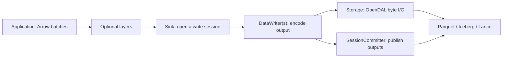

# open-arrow-sink

A Rust library for writing Apache Arrow `RecordBatch` values to Parquet
directories, Iceberg tables, and Lance datasets. Use it as the output stage of
a data preparation or ingestion pipeline.

[open-arrow-access](https://github.com/dentiny/open-arrow-access) is the upstream
read side: it discovers and decodes source data into Arrow batches. Your pipeline
processes those batches, then passes them to open-arrow-sink for writing. The two
libraries have no compile-time dependency; any compatible Arrow producer works.

```text
Sources → open-arrow-access → Arrow batches → your processing → open-arrow-sink → datasets
```

## Architecture



| Component | Responsibility | Code |
| --- | --- | --- |
| Core | Sink, writer, session, layer, options, and capability contracts | [core/src](core/src) |
| Layers | Compression policy, concurrent writes, metrics, schema adaptation, URL-to-blob selection | [layer/src](layer/src) |
| Storage | OpenDAL operators, credentials, byte streams, HTTP and download budgets | [storage/src](storage/src) |
| Sinks | Destination validation, encoding, and backend-specific publication | [sink](sink) |
| Facade | Re-exports and opt-in backend features | [src/lib.rs](src/lib.rs) |

Core is independent of storage and backends. Layers and backends build on these
contracts; the application owns the runtime and input pipeline.

A reusable `Sink` opens an owned `Writer` with a fixed schema. The lifecycle is
`open → write batches → commit` or `abort`. Writes accept data; commit finishes
writers and publishes their outputs through one session committer. Drop never
commits or performs async cleanup. Failed or cancelled writes make the writer
terminal; abort stops I/O and retains persisted output. A commit error can leave
publication uncertain, so check the destination before retrying.

For a complete input stream, import `SinkExt` and let the sink own the loop:

```rust,ignore
use open_arrow_sink::{SinkExt, WriteOptions};

let summary = sink
    .write_all(destination, schema, WriteOptions::default(), stream)
    .await?;
```

`stream` can be any `Send` stream of `open_arrow_sink::Result<RecordBatch>`,
including an unpinned async stream. Map errors from other libraries at the input
boundary with `stream.map_err(open_arrow_sink::Error::backend)` (using
`futures::TryStreamExt`); this preserves the native error and its source chain. The helper opens once, writes
one batch at a time, and commits at EOF, even for empty input. Input or write
errors trigger best-effort abort and return the original `Error` even if abort
also fails.
Open errors return before reading input. Commit errors return directly because
commit consumes the writer and may have already published data. Cancelling the
future or panicking drops the writer without async cleanup.

`write_all` returns the backend's `CommitSummary`, including actual committed
rows after filtering and blob recovery.
See the [Parquet example](sink/parquet/examples/write_directory.rs) for a runnable
use of `write_all`.

`Layer<S>` wraps a sink while preserving its request type.
`sink.layer(a).layer(b)` runs through `b → a → sink`.
`ParallelIngestionLayer` uses `ParallelSink` to create several data writers with one
committer. Arrow layers control writes; OpenDAL layers control byte I/O.

## Backends and examples

| Backend | Facade feature | Modes | Publication | Example |
| --- | --- | --- | --- | --- |
| Parquet directory | `sink-parquet` | Create, Append | Files may be visible before commit; no directory transaction | [write_directory.rs](sink/parquet/examples/write_directory.rs) |
| Iceberg table | `sink-iceberg` | Append to an existing table | One native fast-append transaction | [append.rs](sink/iceberg/examples/append.rs) |
| Lance dataset | `sink-lance` | Create, Append, Overwrite | One atomic manifest for data and requested indexes | [write_lance.rs](sink/lance/examples/write_lance.rs) |

Facade features default to empty. Enable the backend you need; see
[Cargo.toml](Cargo.toml) for cloud and codec features. Options default to Create
and Unordered; Iceberg requires explicit Append. Bundled sinks reject
PreserveInput. Check `Sink::capability()` and backend validation for supported
options.

Run the Parquet example with a new destination directory:

```sh
cargo run --locked -p open-arrow-sink-parquet --example write_directory -- /tmp/my-first-arrow-output
```

For integration details, start with the examples above and the
[write options](core/src/request.rs). Generate API documentation locally:

```sh
cargo doc --workspace --all-features --no-deps --locked --open
```

When an application already has an OpenDAL operator configured with an endpoint,
region, credentials, or layers, bind it to a target URL without rebuilding it:

```rust,no_run
use open_arrow_sink::storage::{Storage, Url, opendal::Operator};

fn destination(operator: Operator, url: &Url) -> open_arrow_sink::Result<Storage> {
    Storage::for_url(operator, url)
}
```

`Storage::for_url` maps `s3://bucket/prefix/data.lance` to the bucket root
`s3://bucket/`, and local file URLs to `file:///`. The operator must address the
same backend and bucket with its root set to `/`. For an operator rooted at a
prefix, use `Storage::new(operator, base_url)` with the corresponding explicit
base. The helper also works for custom blob sources registered through
`StorageResolver::with_storage`; registrations remain scoped to each namespace.

Blob downloads limit concurrent groups and HTTP requests, with no configured
maximum for blob size, combined group size, or buffered payload bytes. Complete
payloads are buffered in memory. `BlobDownloader::new(concurrency)` configures
the group concurrency; the default is 64. Read chunks remain 2 MiB regardless of
payload size.

For S3 blob downloads, a single `md5=<32 hexadecimal digits>` query (as in PMC
content URLs) is stripped before resolving source storage. The payload checksum
is not verified. Other storage queries remain unsupported; HTTP(S) queries are
preserved. For the public PMC bucket, register an unsigned S3 operator configured
with `region("us-east-1")` and `skip_signature()` via `with_source_storage`.

Storage retry and timeout policies are opt-in through `StorageConfig`. With
`RetryConfig` enabled, HTTP 429 and 503 responses honor `Retry-After` in seconds
or HTTP-date form. The wait is the larger of the server delay and exponential
backoff; missing or invalid headers use normal backoff. A server delay above
`max_delay` returns the error immediately instead of retrying before the server
allows it. A server delay pauses every new attempt through the same operator.
`max_retries` still limits retries after the initial attempt.
`TimeoutConfig` applies to each attempt and body read, excluding backoff and
server delays.
Cancelled operations stop waiting and issue no further requests.

## Commit results

`Writer::commit()`, `SessionCommitter::commit(outputs)`, and
`SinkExt::write_all()` return a `CommitSummary` for the successfully published session. `rows_committed` counts
actual output rows across all physical writers, including when blob recovery
skips input rows. `rows_failed_blobs` counts each input row with a failed selected
blob once, even if several blobs fail; it overlaps `rows_skipped` under `SkipRow`
and includes retained rows under `Null`. These counters are local to the session;
`DownloadBlobLayer::metrics()` remains a cumulative observation handle.

```rust,ignore
let summary = writer.commit().await?;
progress.finish(summary.rows_committed, summary.rows_failed_blobs);
```

Empty sessions report zero rows; errors
return no summary and do not imply publication was rolled back. Custom writers,
committers, and decorators must return or forward the summary.

`SkipRow` and `Null` recover missing blobs and HTTP 403s; configuration and unknown
errors propagate by default. Inspect `SourceDownloadError::find(&error)`, or return
`Error::backend(SourceDownloadError { recoverable: true, source: error })` from a
custom downloader to opt into row recovery. This uses actual downloads, without probes.

## Extending and developing

Implement a **sink** for a new destination, or a **layer** for reusable policy or
batch transformation. Read [Extending](docs/extending.md) for the contracts and
runnable examples. Extensions can live in separate crates without registration.

Use a Rust toolchain supporting edition 2024. Lance dependencies also need
`protoc`. Install the formatting and lint tools:

```sh
rustup component add rustfmt clippy
cargo install taplo-cli --locked
```

Run the workspace checks from the repository root:

```sh
make lint
cargo test --workspace --locked
```

`make lint` checks Rust and TOML formatting, validates TOML and workspace metadata,
and runs Clippy for all targets and features with warnings treated as errors.
Use `make fmt` to format Rust and TOML files, or `make lint-rust` and
`make lint-toml` to run the individual lint checks.

MIT licensed.

### Plan parallel ingestion from source metadata

`layer::ParallelIngestionLayer` chooses an initial writer count before consuming
input. It reuses the unordered dispatcher's one-batch-per-writer backpressure and
one shared session commit; no whole-input buffering or background executor is
introduced.

```rust,ignore
use std::num::NonZeroUsize;
use open_arrow_sink::{SinkExt, WriteOptions};
use open_arrow_sink::layer::{InputSizeHint, ParallelIngestionLayer};

// Obtained from source metadata before polling records, not from final metrics.
let hint = InputSizeHint::SourceBytes(40 * 1024 * 1024 * 1024);
let policy = ParallelIngestionLayer::new(NonZeroUsize::new(512 * 1024 * 1024).unwrap())
    .with_input_size(hint)
    .with_max_writers(NonZeroUsize::new(8).unwrap());
let plan = policy.plan(); // ~80 files by source-byte proxy; at most 8 writers
let sink = sink.layer(policy);
let summary = sink.write_all(destination, schema, WriteOptions::default(), stream).await?;
```

`SourceBytes` explicitly uses a coarse 1:1 byte proxy, not a compression prediction.
Use `OutputBytes` when the application has a better estimate after projection,
filtering, encoding, or blob materialization. `Unknown` defaults to one writer;
`with_fallback_writers` configures it, still capped by `with_max_writers`.
Both exact and estimated source sizes are only layout hints. Even zero consumes
all incoming records; estimates never limit rows or signal EOF.

The layer forwards its target to backend file rotation and rejects a conflicting
caller target. Option-changing layers belong outside the ingestion layer; inner
layers must preserve its target. File size is a soft target. Writers may produce
several files, and partition/tail files can make actual counts differ from the
plan. The default maximum is eight writers. This bounds in-flight batches, not
process memory or active files for partitioned backends. Source read-ahead,
encoding state, and upload buffers require separate budgets. In particular, an
upstream reader with unbounded prefetch is not made memory-bounded by this layer.
This overlaps I/O without promising parallel CPU encoding. Use unordered write options only when the COPY operation permits it.
EOF finishes all writers and publishes once through the existing committer.

For an explicit writer count, use
`ParallelIngestionLayer::fixed(NonZeroUsize::new(4).unwrap())`. This preserves
`WriteOptions.target_file_size` (including backend defaults when unset) and uses
the same dispatcher, ordering checks, and single session commit. Without an
automatic target, size hints do not estimate file counts; the fallback and maximum
writer settings determine concurrency. There is one public parallel write layer
for both automatic planning and explicit concurrency.
