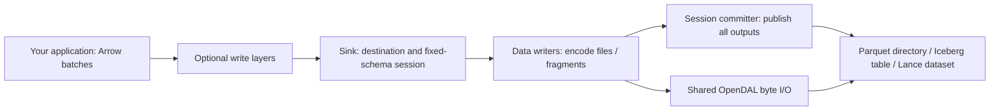

# open-arrow-sink

A Rust library for data developers writing Apache Arrow `RecordBatch` values to
Parquet directories, Iceberg tables, and Lance datasets. Compose a destination
with write layers for compression, concurrency, or URL-to-blob ingestion.
Use it in an ingestion pipeline, export job, or application that already produces Arrow batches.

The library is independent of
[open-arrow-access](https://github.com/dentiny/open-arrow-access): any Arrow
producer can supply batches. Your application owns its runtime, credentials,
batch production, and decision to commit or abort.

## Write your first dataset

From a checkout, run the local Parquet example against a **new** directory:

```sh
cargo run --locked -p open-arrow-sink-parquet --example write_directory -- /tmp/my-first-arrow-output
```

For an application, use the repository dependency below until your intended
release is published. Pin `rev` to a reviewed commit for reproducible builds;
after publication, use the matching crates.io version instead.

```toml
[dependencies]
open-arrow-sink = { git = "https://github.com/dentiny/open-arrow-sink", default-features = false, features = ["sink-parquet"] }
arrow-array = "58.4"
tokio = { version = "1", features = ["macros", "rt-multi-thread"] }
```

```rust,no_run
use arrow_array::{ArrayRef, Int64Array, RecordBatch};
use open_arrow_sink::{
    Ordering, Sink, WriteOptions,
    parquet::{ParquetDirectorySink, Url},
};
use std::sync::Arc;

#[tokio::main]
async fn main() -> Result<(), Box<dyn std::error::Error>> {
    let destination = Url::from_directory_path(std::path::absolute("new-output")?)
        .map_err(|_| "invalid destination path")?;
    let batch = RecordBatch::try_from_iter([(
        "id",
        Arc::new(Int64Array::from(vec![1, 2, 3])) as ArrayRef,
    )])?;
    let mut writer = ParquetDirectorySink::default()
        .open(
            destination,
            batch.schema(),
            WriteOptions::default().with_ordering(Ordering::Unordered),
        )
        .await?;
    if let Err(error) = writer.write(batch).await {
        let _ = writer.abort().await;
        return Err(error.into());
    }
    let summary = writer.commit().await?;
    println!("Committed {} rows", summary.rows_written);
    Ok(())
}
```

`open` fixes the schema. `write` accepts batches; only `commit` finishes and
publishes according to the backend's rules. Drop never commits or performs async
cleanup. After a failed or cancelled write, abort or drop that writer.

All bundled sinks require explicit `Ordering::Unordered`; none guarantees input
row order on scans. The shared default is `PreserveInput`, so it is rejected.
The default write mode is `Create`. Iceberg requires explicit `WriteMode::Append`.

## Choose a destination

| Destination | Facade feature | Request | Modes | Publication |
| --- | --- | --- | --- | --- |
| [Parquet directory](sink/parquet/README.md) | `sink-parquet` | `Url` | Create, Append | Files can be visible before commit; no directory transaction |
| [Iceberg table](sink/iceberg/README.md) | `sink-iceberg` | SDK `TableIdent` | Append to an existing table | One native fast-append transaction |
| [Lance dataset](sink/lance/README.md) | `sink-lance` | `Url` | Create, Append, versioned Overwrite | Native data manifest, then optional index commits |

See the [support matrix](docs/support.md) for partitioning, codecs, indexes, blobs,
storage versions, and restrictions. Features are opt-in and the facade defaults
are empty. Core contracts, layers, and shared storage are always exported;
enabling a feature exposes a sink, while constructing it selects its behavior.

## How the pieces compose



A sink owns backend semantics and a typed request. A layer wraps a sink while
preserving that request type. Ordinary bundled writes use one data writer;
`UnorderedWriteLayer` uses several writers in one backend publication session.
OpenDAL layers configure byte I/O separately from Arrow write layers.

```rust,ignore
use std::num::NonZeroUsize;
use open_arrow_sink::{SinkExt, parquet::ParquetDirectorySink, layer::UnorderedWriteLayer};

let sink = ParquetDirectorySink::default()
    .layer(UnorderedWriteLayer::new(NonZeroUsize::new(4).unwrap()));
// Open with Ordering::Unordered, write batches, then commit once.
```

## Documentation

| Goal | Guide |
| --- | --- |
| Configure features, local/cloud storage, and write lifecycles | [Usage](docs/usage.md) |
| Understand ownership, execution, and publication boundaries | [Architecture](docs/architecture.md) |
| Choose options and handle failures | [Options and contracts](docs/options.md) |
| Compose ordering, compression, concurrent writes, and downloads | [Layers](layer/README.md) |
| Add a new destination | [Extend a sink](docs/extending-sinks.md) |
| Add a new write decorator | [Extend a layer](docs/extending-layers.md) |
| Build, validate documentation, and prepare a release | [Development](docs/development.md) |

See the [documentation index](docs/README.md) for the full reading path.
MIT licensed.
