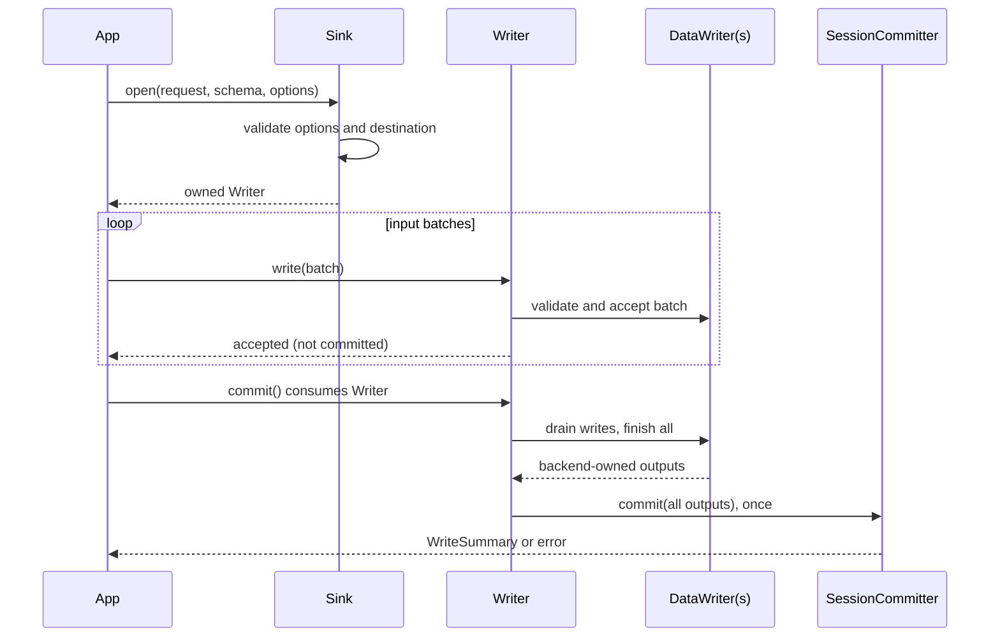
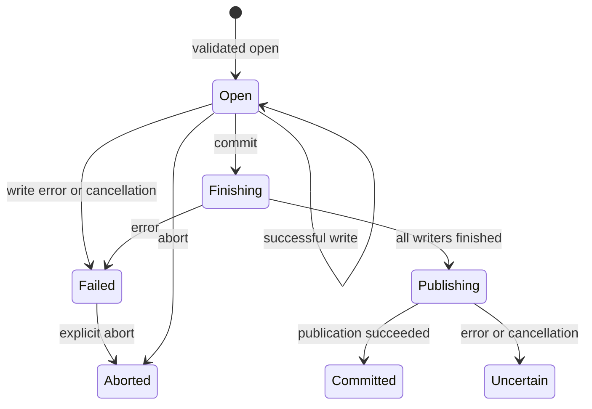

# Architecture

An application supplies a fixed Arrow schema, a backend-specific destination, and
`WriteOptions`. A reusable `Sink` opens an owned `Writer`. That writer accepts
batches and ends through consuming `commit` or `abort`; dropping it never commits.
The API separates encoding from publication so concurrency does not require a
separate transaction for every worker.

## Workspace boundaries

| Crate / directory | Owns | Does not own |
| --- | --- | --- |
| `open-arrow-sink` / `src` | Facade exports and optional backend features | Runtime or pipeline execution |
| `open-arrow-sink-core` / `core` | Sink/writer/session/layer traits, options, capabilities, validation, blob contracts | Backend I/O or catalog transactions |
| `open-arrow-sink-layer` / `layer` | Option overrides, bounded concurrent dispatch, URL-to-blob transformation | File naming or native publication metadata |
| `open-arrow-sink-storage` / `storage` | OpenDAL byte streams, URL namespaces, HTTP budgets, I/O policies | Arrow encoding or destination write modes |
| `open-arrow-sink-parquet` / `sink/parquet` | Directory validation, Parquet encoding/rolling, append handling | A table catalog |
| `open-arrow-sink-iceberg` / `sink/iceberg` | Existing-table validation, partition routing, native fast append | Table creation or schema evolution |
| `open-arrow-sink-lance` / `sink/lance` | Fragment/blob writers, native manifests, optional indexes | Input production or general schema reconciliation |

Core does not depend on storage or a backend. Storage depends on core; layers use
core. Backend crates use core and storage; the facade re-exports them.
There is no dependency on `open-arrow-access`. Its readers can feed a writer just
like any other producer of compatible Arrow batches.

## One session, one publication authority

`DataWriter::finish(&mut self)` finishes physical output without publishing table
or dataset metadata. Its output is backend-owned: Parquet row counts, Iceberg
`DataFile`s with row counts, or Lance transactions with row counts.
`SessionCommitter` interprets those outputs and owns publication. A finished data
writer stays abortable until publication begins.

`WriteSession::into_writer()` adapts exactly one data writer to `Writer`, sharing
failure and cancellation handling. All bundled ordinary non-blob writes use this
path. Lance blob writes use the same fragment publication path.

## Layers and execution

`Layer<S>` constructs a wrapping sink without I/O and preserves `S::Request`.
`sink.layer(a).layer(b)` puts `b` outside `a`: open flows through b → a → sink.
Ordering and compression layers change options and forward capabilities. A record
transform can expose one input schema and give its inner writer a different one;
schema evolution layers remap fields. URL downloading is independent of the layer stack.

`ParallelSink` reserves one destination and creates independent data writers with
disjoint output ownership plus one committer. `UnorderedWriteLayer` dispatches
whole nonempty batches to available writers, keeping at most one in-flight batch
per writer. It spawns no tasks; work advances while write/commit/abort is polled.
Lance may use native Tokio workers behind its writers. Accepted data and output
metadata can remain buffered until commit. Increasing concurrency multiplies
encoding buffers and, for Iceberg, active partition writers.

Arrow write layers and OpenDAL I/O layers operate at different boundaries:
compression options select output encoding; an OpenDAL retry layer configures
individual storage operations. Retrying bytes does not make a whole session safe
to replay.

## Validation, failure, and visibility

Validate capabilities before destination I/O, then backend parameters and the
actual destination. Capabilities describe the configured sink, but request-time
restrictions still apply: for example, Lance Append requires an existing dataset.
Every batch must exactly match the session schema,
including order, types, nullability, and metadata. No implicit cast occurs.

Drop can end any owned session without asynchronous cleanup. A commit consumes
the writer even on failure. Errors return directly without automatic abort or
deletion. Explicit abort stops I/O and retains output. Deleting files on an
ambiguous error could destroy already committed data. Reconcile with the destination before retrying.

Publication is backend-specific. Parquet files may be visible while writing;
commit completes footers. Iceberg publishes
all files in a single fast-append transaction. Lance publishes one data manifest,
then requested indexes in separate native commits. An index failure can therefore
mean data and some indexes are already committed.

## Resource ownership

A `Storage` clone shares its configured operator and HTTP limiter. Native SDK
adapters retain that storage so data, metadata, reads, and cleanup use the same
credentials and namespace. Iceberg injects it through the catalog's
`OpenDalStorageFactory`; table metadata still selects the locations.

`BlobDownloader` owns explicit download, chunk, and application-memory budgets.
Lance owns one by default; configure a shared `Arc<BlobDownloader>` to share
limits across sinks. Blob URI inputs are materialized automatically. Reservations follow returned bytes and shared
Arrow buffers through the write queue. The SDK chooses inline, packed, or
dedicated storage. SDK encoding and transport buffers have separate limits.
An explicit `HttpConcurrencyLimitLayer` can share HTTP capacity across downloaders
and destination storage. See [storage](../storage/README.md).
